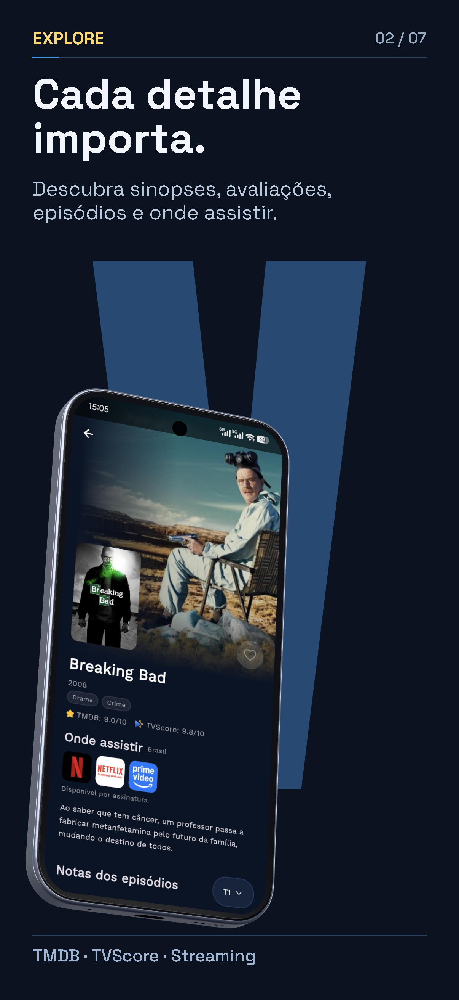
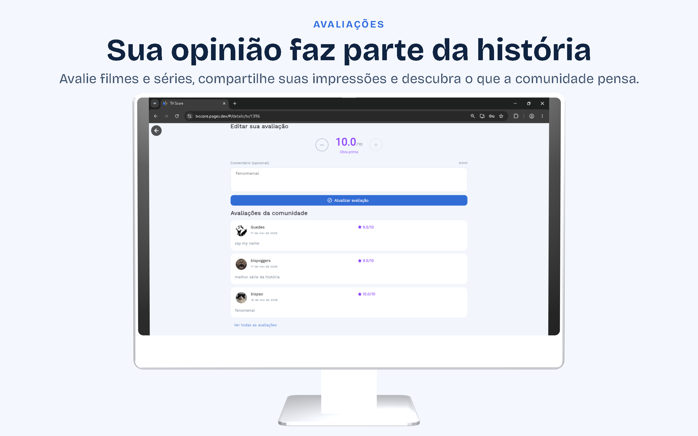

<div align="center">
  

  <h1>TVScore</h1>
  <p>Explore filmes e séries, descubra onde assistir e organize suas avaliações e seus favoritos.</p>
  <p>
    <a href="https://tvscore.pages.dev/">Abrir versão Web</a> ·
    <a href="https://github.com/victorbispoo/tvScoreFrontFlutter/releases">Android no GitHub Releases</a>
  </p>
</div>

## TVScore Mobile

Para instalar no Android, abra o [GitHub Releases](https://github.com/victorbispoo/tvScoreFrontFlutter/releases) e baixe o arquivo .apk na seção **Assets**.

<p align="center">
  <a href="assets/readme/mobile/banner.png"></a>
</p>

<p align="center">
  <a href="assets/readme/mobile/01-descubra.png"></a>
  <a href="assets/readme/mobile/02-explore.png"></a>
  <a href="assets/readme/mobile/03-avalie.png"></a>
  <a href="assets/readme/mobile/04-personalize.png"></a>
</p>

<p align="center">
  <a href="assets/readme/mobile/05-escolha.png"></a>
  <a href="assets/readme/mobile/06-seu-espaco.png"></a>
  <a href="assets/readme/mobile/07-comece-agora.png"></a>
</p>

## TVScore Web

<p align="center">
  <a href="assets/readme/web/01-tvscore-web.png"></a>
</p>

<p align="center">
  <a href="assets/readme/web/02-responsividade.png"></a>
  <a href="assets/readme/web/03-aparencia.png"></a>
</p>

<p align="center">
  <a href="assets/readme/web/04-avaliacoes.png"></a>
  <a href="assets/readme/web/05-favoritos.png"></a>
</p>

## Sobre o projeto

O **TVScore** é um Trabalho de Conclusão de Curso desenvolvido em Flutter para Android e Web. O projeto reúne catálogo do TMDB, disponibilidade de streaming no Brasil, biblioteca pessoal e recomendações com base nas preferências e avaliações do usuário.

## Funcionalidades

| Recurso | Descrição |
| --- | --- |
| Catálogo | Carrosséis com destaques, títulos ordenados por nota e ano, categorias por gênero e séries. |
| Pesquisa | Busca por título diretamente no backend, com filtro entre filmes e séries e carregamento de novas páginas durante a rolagem. |
| Filtros do catálogo | Exploração por gênero, ano, faixa de notas e plataforma de streaming. |
| Detalhes | Pôster, imagem de fundo, sinopse, ano, gêneros e nota TMDB. |
| Onde assistir | Plataformas disponíveis no Brasil para cada título, separadas por assinatura, aluguel e compra, com acesso à consulta de disponibilidade. |
| Recomendações personalizadas | Sugestões de filmes e séries com base nas preferências e avaliações do usuário, acompanhadas de explicações sobre a recomendação. |
| Episódios | Seleção de temporada e grid com número, nota TMDB e cores por faixa de avaliação. Episódios sem votos recebem uma indicação própria. |
| Favoritos | Adição, consulta e remoção de títulos, com persistência vinculada à conta no backend. |
| Avaliações pessoais | Notas de 0 a 10 em passos de 0,5, com comentário opcional, edição e exclusão. |
| Comunidade | Avaliações de outros usuários, média TVScore e quantidade de avaliações por título. |
| Minhas avaliações | Consulta do histórico pessoal e ordenação por data ou nota. |
| Conta e sessão | Cadastro, login, restauração de sessão, verificação de expiração do token e logout. |
| Perfil | Contagens de favoritos e avaliações, acesso à biblioteca e personalização local do nome exibido. |

As notas **TMDB**, a média da comunidade **TVScore** e a **avaliação pessoal** são apresentadas separadamente. O score de recomendação indica a relevância de uma sugestão para o usuário e não representa uma nota do título. Filmes e séries são identificados pelo ID TMDB e pelo tipo de conteúdo.

O aplicativo apresenta estados de carregamento, lista vazia, erro e nova tentativa. Quando não há informações de streaming para um título, exibe “Disponibilidade não informada”. Contas sem histórico recebem orientação para informar preferências e avaliar conteúdos.

## Tecnologias

| Tecnologia | Aplicação |
| --- | --- |
| Flutter e Dart | Interface, navegação e lógica do aplicativo |
| Material 3 | Componentes visuais e temas claro, escuro e do sistema |
| Dio | Comunicação HTTP com a API |
| Flutter Secure Storage | Armazenamento seguro da sessão |
| Shared Preferences | Preferências locais do perfil |
| Flutter SVG | Renderização de elementos vetoriais |
| Google Fonts | Tipografia Work Sans |
| HugeIcons | Ícones da interface |
| Flutter Test | Testes de serviços, sessão e widgets |
| Java e Spring Boot | API, autenticação JWT e regras de negócio |
| MySQL | Persistência das contas, favoritos e avaliações |
| Python | Serviço de recomendações personalizadas |
| TMDB | Catálogo, imagens, gêneros e notas de filmes, séries e episódios |
| JustWatch via TMDB | Disponibilidade dos títulos em plataformas de streaming |

## Integração da solução

- **Aplicativo Flutter:** apresenta o catálogo, a pesquisa, os detalhes, a biblioteca pessoal e as recomendações.
- **Backend Java:** autentica usuários, persiste favoritos e avaliações e consulta dados de conteúdos e disponibilidade no TMDB.
- **Serviço Python:** processa preferências e avaliações para produzir recomendações personalizadas de filmes e séries.

Os repositórios dos três componentes estão disponíveis em **Repositórios relacionados**.

## Como executar

### Pré-requisitos

- Flutter com versão do Dart compatível com `^3.12.2`, conforme o [pubspec.yaml](pubspec.yaml).
- Para Android, use o Android SDK e um emulador ou dispositivo com depuração USB.
- Para Web, tenha o Chrome instalado.
- Git e conexão com a internet para acesso à API e às imagens.

### Instalação

```bash
git clone https://github.com/victorbispoo/tvScoreFrontFlutter.git
cd tvScoreFrontFlutter
flutter pub get
flutter doctor
flutter run
```

Para escolher um dispositivo:

```bash
flutter devices
flutter run -d ID_DO_DISPOSITIVO
```

Para executar no navegador, use `flutter run -d chrome`. Ao abrir o aplicativo, você pode entrar, criar uma conta ou continuar explorando.

### Configuração da API

O endereço padrão do backend é:

```text
https://tvscore-backend.onrender.com/api
```

Para utilizar outro servidor, altere o `baseUrl` do Dio em [lib/services/api_services.dart](lib/services/api_services.dart). O endereço deve ser acessível pelo emulador ou dispositivo.

O frontend consome o backend Java. As credenciais de acesso ao TMDB são configuradas no servidor.

### Catálogo de demonstração

Para substituir os destaques da tela Início por um catálogo fixo:

```bash
flutter run --dart-define=USE_MOCK_MOVIES=true
```

Os dados ficam em [lib/data/mock_contents.dart](lib/data/mock_contents.dart). A opção altera o catálogo da tela inicial. Pesquisa, autenticação, favoritos, avaliações e episódios continuam consultando o backend. As imagens também dependem de conexão com a internet.

## Organização do código

```text
lib/
├── assets/        # Logos e recursos visuais
├── controllers/   # Controle dos formulários de autenticação
├── core/          # Tema e estilos compartilhados
├── data/          # Catálogo de demonstração
├── models/        # Modelo de avaliação
├── pages/         # Telas do aplicativo
├── services/      # Autenticação, conteúdos, favoritos e avaliações
├── widgets/       # Cards, carrosséis, formulários e grid de episódios
└── main.dart      # Inicialização, restauração da sessão e navegação

test/
├── support/       # Backend simulado para os testes
└── *_test.dart    # Testes de serviços e interface
```

## Qualidade e testes

Para analisar o código e executar a suíte:

```bash
flutter analyze
flutter test
```

Os testes cobrem autenticação e restauração de sessão, isolamento entre contas, favoritos, avaliações, pesquisa, conversão de gêneros e fluxos de navegação. As respostas HTTP são simuladas nos testes para que a suíte não dependa do backend publicado.

Para conferir a formatação:

```bash
dart format --output=none --set-exit-if-changed lib test
```

## Gerar o APK

```bash
flutter build apk --release
```

O arquivo gerado fica em:

```text
build/app/outputs/flutter-apk/app-release.apk
```

## Repositórios relacionados

- [Aplicativo Flutter](https://github.com/victorbispoo/tvScoreFrontFlutter)
- [Backend Java](https://github.com/GuedesSiilva/BackEnd_Projeto_TvScore)
- [Serviço de recomendações Python](https://github.com/Kaique-Ramiro/recomendador-TvScore)

## Créditos

Dados de filmes, séries, episódios e imagens são fornecidos pelo [TMDB](https://www.themoviedb.org/). Este produto utiliza a API do TMDB, mas não é endossado nem certificado pelo TMDB.

As informações sobre onde assistir são fornecidas pelo **JustWatch**, por meio da integração de disponibilidade do TMDB, considerando a região do Brasil.
